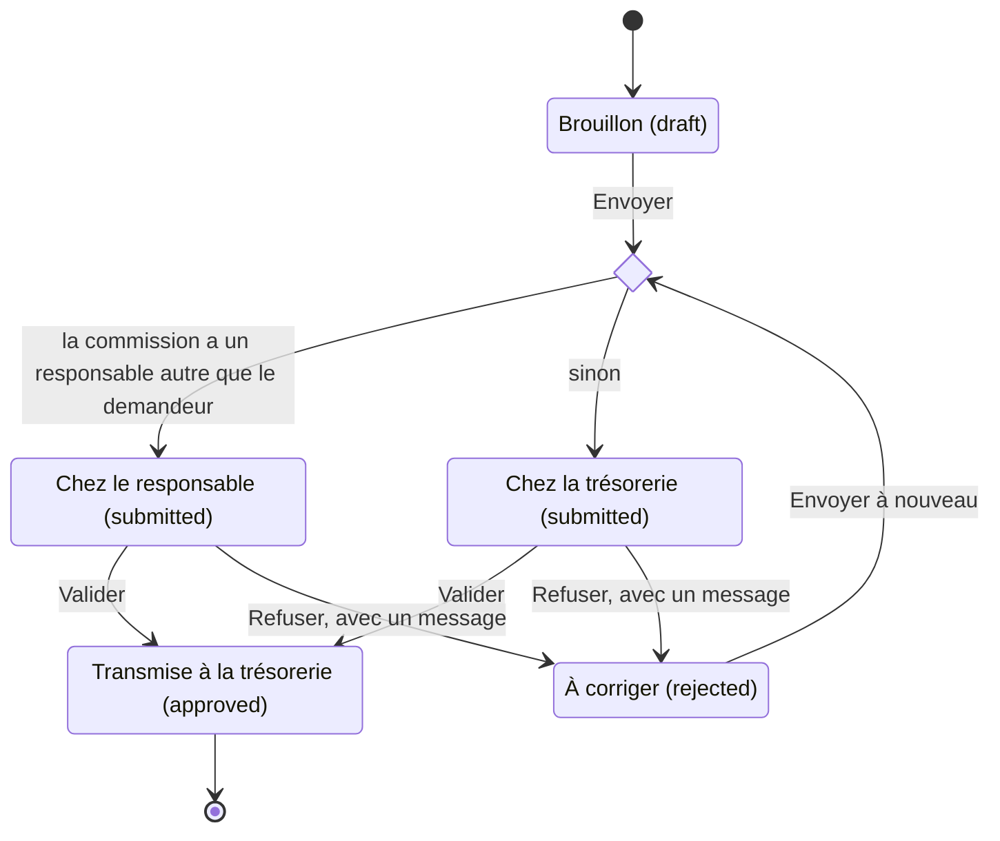

# Notes de Frais

L'application gère deux circuits de notes de frais :
- les notes de sortie, rattachées à une sortie : saisies sur le site, validées dans compta-club (sections suivantes) ;
- les [notes hors sortie](#notes-hors-sortie), pour une formation ou un achat fait pour le club : validées par le responsable de la commission, puis transmises à la trésorerie.

## Soumission des Notes de Frais

Interface VueJS disponible dans la page de chaque sortie :
- Template Twig pour l'envoi du récapitulatif
- API pour récupérer les informations

### Configuration des Taux

Les taux d'indemnités kilométriques sont configurés à deux endroits :
1. `assets/expense-report-form/config/expense-report.json` (client)
2. `config/services.yaml` (server)

⚠️ En cas de modification des taux, mettre à jour les deux fichiers.

## Validation des Notes de Frais

Interface distincte développée en NextJS : [compta-club](https://github.com/Club-Alpin-Lyon-Villeurbanne/compta-club)

Les taux d'indemnités kilométriques sont également configurés dans :
https://github.com/Club-Alpin-Lyon-Villeurbanne/compta-club/blob/main/app/config.ts

## Notes hors sortie

Une note hors sortie rembourse une formation ou un achat fait pour le club, sans lien avec une sortie. Elle remplace le fichier Excel « Note de frais divers » : la demande, l'accord du responsable et le choix entre remboursement et don sont désormais tracés sur le site.

### Qui fait quoi

- Le demandeur fait sa demande (formation ou achat) depuis le menu « Notes de frais » : une ligne par dépense avec son justificatif, puis le choix entre remboursement et don.
- Le responsable de commission valide la note, ou la refuse avec un message : le demandeur la corrige et l'envoie à nouveau. Il ne voit pas le choix entre remboursement et don.
- La trésorerie n'a aucune fonction sur le site et ne reçoit aucun mail : elle travaille dans compta-club, par l'API.

Règles à connaître :

- Tout adhérent connecté peut demander le remboursement d'un achat. Une formation est réservée aux adhérents qui ont un rôle d'encadrement sur la commission (responsable, encadrant, coencadrant, stagiaire ou bénévole d'encadrement).
- Personne ne valide sa propre note, et un responsable sans adresse mail ne valide pas. S'il ne reste aucun responsable, la note va à la trésorerie.
- Sur le site, un gestionnaire des notes de frais n'a rien de plus qu'un autre adhérent : « à valider » ne lui montre que les notes des commissions dont il est responsable.

### Circuit des statuts

Le demandeur ne modifie sa note qu'en brouillon ou à corriger. Une note transmise reste `approved` : compta-club ne la voit pas.

### Écrans

Le menu adhérent gagne une rubrique « Notes de frais ». L'entrée « notes de frais à valider », avec son compteur, n'apparaît qu'aux responsables de commission.

Première étape : type, commission, objet et date. Sous la commission, le demandeur voit à qui sa note sera transmise : le responsable de la commission, ou la trésorerie.

Seconde étape : une ligne par dépense avec son justificatif, le total, puis le choix entre remboursement et don, obligatoire pour envoyer.

« Mes notes de frais » : toutes les notes du demandeur, de sortie comme hors sortie, filtrables par type. Pour chacune : le statut, le message en cas de refus, et les liens « Reprendre » ou « Corriger ». Une note de sortie renvoie vers la page de sa sortie, où elle se remplit.

« Notes de frais à valider » : les notes en attente dans les commissions du responsable.

Détail d'une note vu par le responsable : dépenses, justificatifs et mot du demandeur, puis « Refuser » ou « Valider ».

### Configuration

- `DISPLAY_NOTES_DE_FRAIS` : à faux, le site n'affiche aucune note de frais, de sortie ou hors sortie, et les pages hors sortie répondent 404.
- `AUTHORIZED_IDS_FOR_EXPENSE_MANAGEMENT` : identifiants utilisateur des gestionnaires des notes de frais, séparés par des virgules. C'est la trésorerie : elle agit par l'API, depuis compta-club.
- Rôle `responsable-commission`, donné sur une commission dans l'administration : ses titulaires valident les notes de cette commission, sauf s'ils sont supprimés, doivent renouveler leur adhésion ou n'ont pas d'adresse mail. Il n'y a rien d'autre à configurer.
- `expense_report.horsSortie` dans `config/services.yaml` : délai d'envoi par type (`delaiEnvoiJours`), seuil d'avertissement (`seuilAvertissement`), taux kilométrique des formations (`formation.tauxKilometrique`) et plafonds par type (`<type>.plafonds`). Les valeurs suivent la politique de remboursement du club. Ce barème est distinct des taux des notes de sortie.

### Pour un développeur

- Contrôles : `src/Service/NoteDeFrais/ControlesNoteHorsSortie.php`. Chaque contrôle a un moment (création, chaque envoi, premier envoi, changement de commission, lecture) et un niveau : bloquant, l'API refuse ; avertissement, l'API l'expose dans `avertissements`. Ajouter un contrôle, c'est une fonction, une ligne dans `controles()` et un test API. Les pages affichent les messages renvoyés par l'API : un nouveau contrôle ne les change pas.
- Plafonds : en configuration seulement. `<type>.plafonds.parNature` plafonne une nature sur chaque ligne (`portee: ligne`) ou sur son total dans la note (`portee: note`) ; `<type>.plafonds.total` plafonne le remboursable de la note.
- Montants figés : à chaque envoi, `ExpenseReportCalculator::figerNoteHorsSortie()` enregistre le total déclaré, le total remboursable et, pour une formation, le taux kilométrique. Ce que le responsable a validé reste ce que la trésorerie paie, même si le barème change ensuite. Un brouillon ou une note à corriger suit le barème en vigueur.
- Valideurs : `ValideursNoteHorsSortie` est la seule source. Les droits (`ResponsableNoteDeFraisVoter`), la liste « à valider », le compteur du menu, les mails et la phrase « Validée par … » en dépendent. Les valideurs sont recalculés à chaque lecture.
- Mails : tous ceux d'une note hors sortie partent de `NotificationsNoteHorsSortie`, une fois le changement de statut enregistré ; le listener Doctrine des notes de sortie les ignore. Ils vont au demandeur et aux valideurs, jamais à la trésorerie.
- compta-club : `/admin/notes-de-frais` exclut les notes hors sortie (`ExpenseReportExtension`), car compta-club suppose qu'une note a une sortie. Voir la [décision](decisions/2026.10.11-notes_de_frais_hors_sortie.md).
- Code : application Vue dans `assets/notes-de-frais/`, pages dans `NoteDeFraisController`, opérations d'API sur l'entité `ExpenseReport`, services dans `src/Service/NoteDeFrais/`.
- Tests : `tests/Api/NoteHorsSortie*Test.php`, sur le socle `ExpenseReportApiTestCase`. En local, ces fichiers peuvent dépasser la mémoire par défaut de PHP : `php -d memory_limit=1G bin/phpunit <fichier>`. Les pages n'ont pas de test automatisé.

### Avant la mise en production

`DISPLAY_NOTES_DE_FRAIS` vaut déjà vrai à Lyon : la mise en production ouvre l'outil à Lyon. Dans l'ordre :

1. [ ] Faire la recette sur staging avec de vrais rôles, mails compris : les droits des données de démo ne reflètent pas la prod.
2. [ ] Vérifier que `DISPLAY_NOTES_DE_FRAIS` vaut faux à Chambéry et à Clermont.
3. [ ] Vérifier en prod les responsables de chaque commission. Une commission sans responsable envoie tout à la trésorerie.
4. [ ] Décider si la formation est proposée dès maintenant : la politique de remboursement qui fixe son barème est-elle votée ?
5. [ ] Mettre en production, le même jour dans tous les clubs : les migrations passent au déploiement.

Retour arrière : le `down()` de la première migration échoue dès qu'une note hors sortie existe, et revenir au code d'avant sans annuler la migration enverrait les notes hors sortie dans `/admin/notes-de-frais` (compta-club). Mieux vaut corriger en avant.

Ne pas créer de groupe de travail pour l'instant : prévus en commissions masquées, ils ne sont pas encore proposés dans le formulaire.

Autre club : la phrase déclarée nomme le Club Alpin de Lyon et le barème est commun à tous les clubs ; à adapter avant d'activer `DISPLAY_NOTES_DE_FRAIS`.
