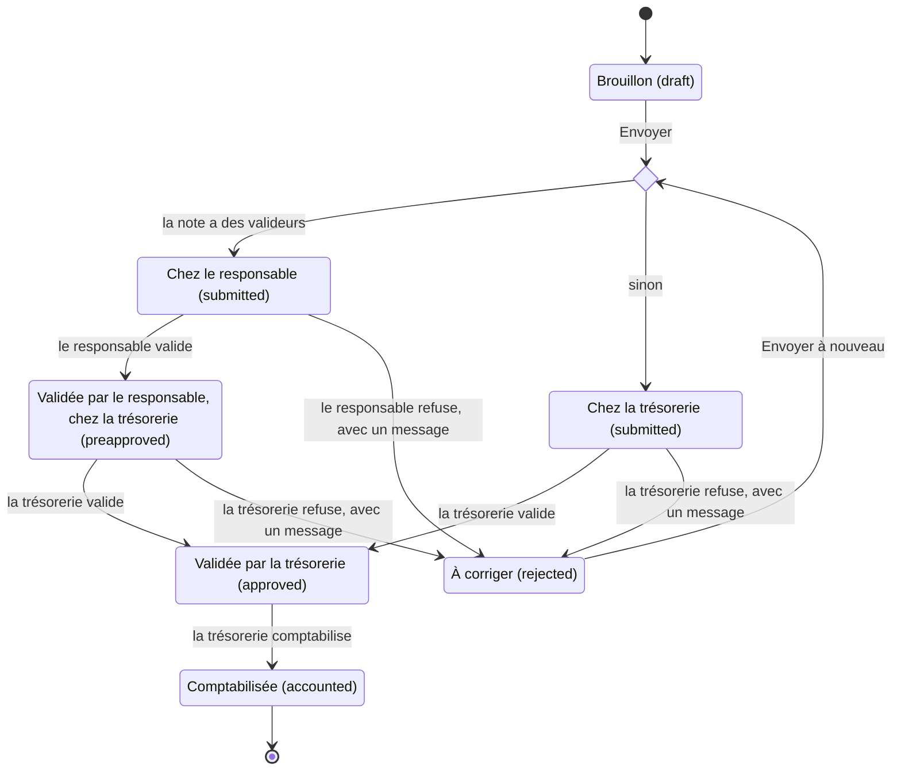
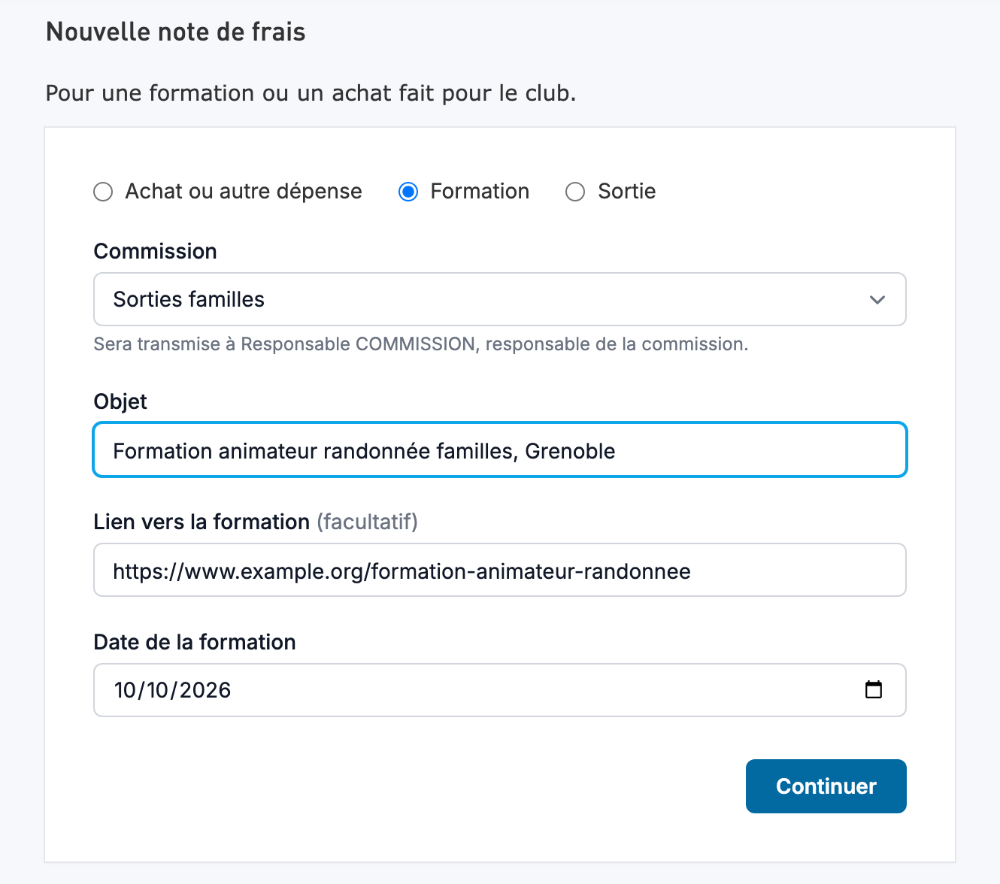
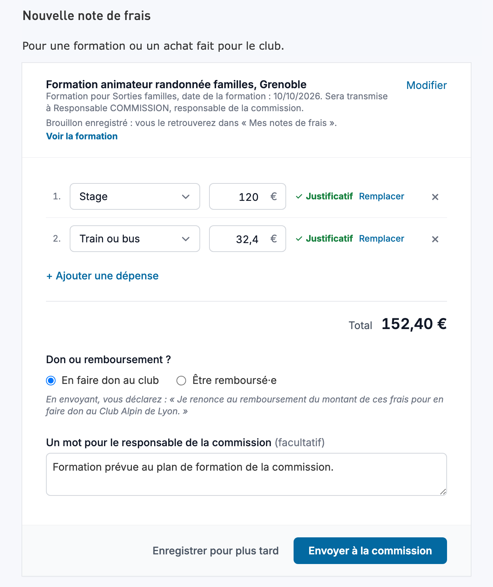
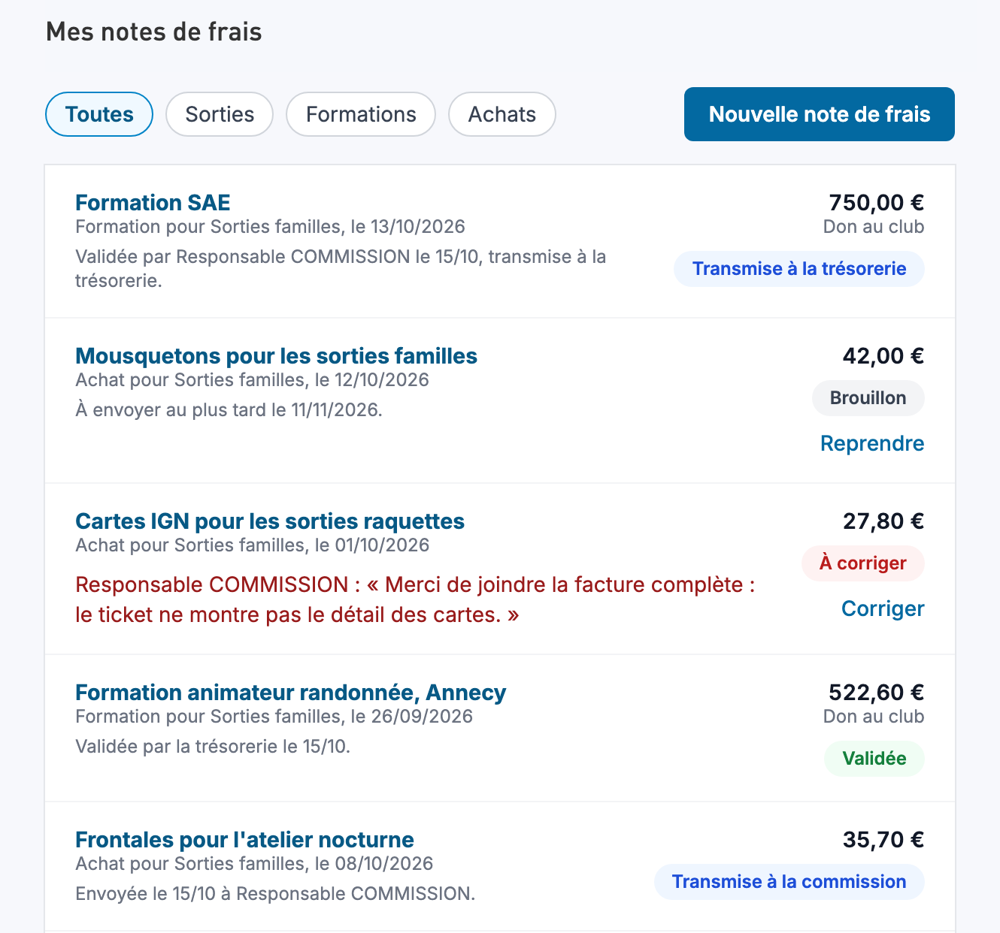
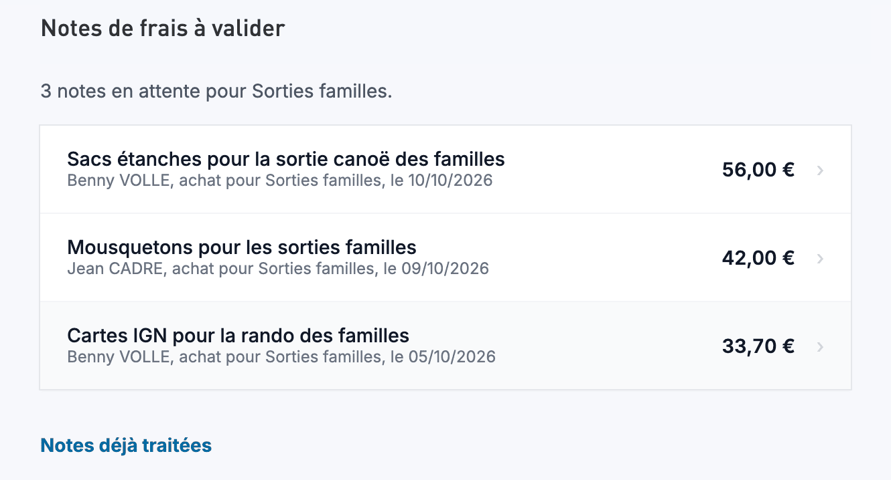
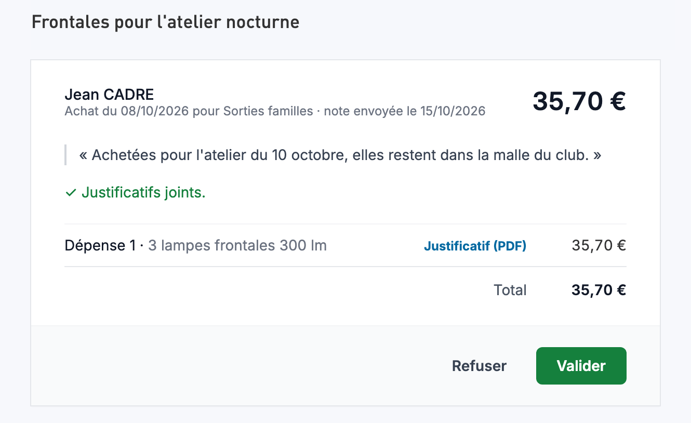

# Notes de Frais

L'application gère deux circuits de notes de frais :
- les notes de sortie, rattachées à une sortie : saisies sur le site, validées et comptabilisées par la trésorerie dans compta-club (sections suivantes) ;
- les [notes hors sortie](#notes-hors-sortie), pour une formation ou un achat fait pour le club : validées sur le site par le responsable de la commission, puis par la trésorerie dans compta-club.

## Soumission des Notes de Frais

Interface VueJS disponible dans la page de chaque sortie :
- Template Twig pour l'envoi du récapitulatif
- API pour récupérer les informations

### Configuration des Taux

Les taux d'indemnités kilométriques sont configurés à deux endroits :
1. `assets/expense-report-form/config/expense-report.json` (client)
2. `config/services.yaml` (server)

⚠️ En cas de modification des taux, mettre à jour les deux fichiers.

## Validation des Notes de Frais

Interface distincte développée en NextJS : [compta-club](https://github.com/Club-Alpin-Lyon-Villeurbanne/compta-club). La trésorerie y valide, refuse et comptabilise toutes les notes, de sortie comme hors sortie, et télécharge leur PDF. Elle passe par l'API de la plateforme.

Les taux d'indemnités kilométriques sont également configurés dans :
https://github.com/Club-Alpin-Lyon-Villeurbanne/compta-club/blob/main/app/config.ts


## Notes hors sortie

Une note hors sortie rembourse une formation ou un achat fait pour le club, sans lien avec une sortie. Elle remplace le fichier Excel « Note de frais divers » : la demande, les validations et le choix entre remboursement et don sont désormais tracés.

### Le circuit

Deux validations, puis la comptabilisation :

1. Le demandeur fait sa demande sur le site, depuis le menu « Notes de frais » : une ligne par dépense avec son justificatif, puis le choix entre remboursement et don.
2. Le responsable de la commission valide la note ou la refuse, sur le site. Il ne voit pas le choix entre remboursement et don.
3. La trésorerie valide la note ou la refuse, dans compta-club, puis la comptabilise.

Une note sans valideur (voir les règles ci-dessous) va directement à la trésorerie dès l'envoi.



Règles à connaître :

- Les notes hors sortie, achat comme formation, sont réservées aux adhérents qui ont un rôle d'encadrement (encadrant, co-encadrant, initiateur stagiaire, bénévole d'encadrement) ou de responsable de commission, dans n'importe quelle commission : la note peut aller à une autre commission que celle du rôle. Le rôle est contrôlé à la création seulement : un demandeur qui le perd termine ses notes commencées. La rubrique du menu disparaît avec son rôle : il retrouve ses notes à l'adresse `/notes-de-frais` (« Mes notes de frais ») ou par les liens des mails.
- Les valideurs d'une note sont les responsables de sa commission, sauf le demandeur et ceux dont le compte est supprimé ou verrouillé, qui doivent renouveler leur adhésion ou qui n'ont pas d'adresse mail. Ils sont recalculés à chaque lecture : si l'on retire son rôle à un responsable qui ne répond pas, ses notes restent aux autres responsables de la commission, ou passent à la trésorerie s'il n'en reste aucun.
- À l'inverse, une note partie à la trésorerie faute de responsable passe, sans mail, au responsable qui redevient actif (il renouvelle son adhésion) ou qu'on nomme entre-temps. Il la voit à sa prochaine visite, par le compteur du menu ; la trésorerie ne la voit plus.
- Un refus porte toujours un message. Le demandeur corrige sa note et l'envoie à nouveau : elle repasse par le responsable s'il y en a un, même quand c'est la trésorerie qui l'a refusée.
- Le demandeur ne modifie sa note qu'en brouillon ou à corriger. Celui qui décide d'une note qui a quitté son étape lit « Cette note a déjà été traitée. ».
- Le demandeur reçoit un mail à chaque étape, avec le lien « Voir ma note » : envoi, validation par le responsable, validation par la trésorerie, refus (avec le message et le lien « Corriger ma note »), comptabilisation. Chaque valideur reçoit « Note de frais à valider », à l'envoi seulement. Aucun mail ne part vers la trésorerie.

### La trésorerie travaille dans compta-club

Le site n'a aucune fonction de trésorerie : ni liste, ni compteur, ni bouton. Un gestionnaire des notes de frais n'y a aucune fonction de plus qu'un autre adhérent ; ses droits sur l'API servent à compta-club.

Dans compta-club, la trésorerie :

- trouve dans « À valider » les notes qui l'attendent : celles qu'un responsable a validées, et celles qui lui arrivent directement (« Directement à la trésorerie ») ; une note encore chez son responsable n'y apparaît pas ;
- ouvre la page d'une note : validation du responsable, dépenses et justificatifs, total déclaré et total remboursable, don ou remboursement, libellé comptable ;
- approuve, refuse avec un message, comptabilise, et télécharge le PDF d'une note approuvée ou comptabilisée.

Ses décisions sont signées « la trésorerie » sur le site, dans les mails et dans compta-club. Le détail est dans la documentation de compta-club ([README](https://github.com/Club-Alpin-Lyon-Villeurbanne/compta-club#readme) et [API.md](https://github.com/Club-Alpin-Lyon-Villeurbanne/compta-club/blob/main/API.md)).

### Écrans

Le menu adhérent gagne une rubrique « Notes de frais », pour ces rôles seulement. L'entrée « notes de frais à valider », avec son compteur, n'apparaît qu'aux responsables de commission. Un autre adhérent qui ouvre « Nouvelle note de frais » lit à qui les notes sont réservées ; « Mes notes de frais » lui reste ouverte, sans le bouton de nouvelle note : un demandeur qui a perdu son rôle y retrouve ses notes. Les mails mènent à la page de la note ou au formulaire de correction ; le fil d'Ariane de la page d'une note mène à « Mes notes de frais ».


Première étape du formulaire : type, commission, objet et date. Le type « Sortie » n'ouvre pas de formulaire : il explique qu'une note de sortie se fait depuis la sortie, à quelles conditions, avec un lien vers « mes sorties passées » et le formulaire de signalement du site. Sous la commission, le demandeur voit à qui sa note sera transmise : les responsables de la commission, nommés, ou la trésorerie.



Seconde étape : une ligne par dépense avec son justificatif, le total, le choix entre don et remboursement (le don en premier, rien de coché, obligatoire pour envoyer), et un mot facultatif pour les responsables de la commission (« pour le responsable » s'il n'y en a qu'un, « pour la trésorerie » quand la note va directement à elle). Le bouton dit à qui part la note : « Envoyer à la commission » ou « Envoyer à la trésorerie ».



« Mes notes de frais » : toutes les notes du demandeur, de sortie comme hors sortie, filtrables par type, et le bouton « Nouvelle note de frais ». Pour chacune : où elle en est (« Brouillon », « Transmise à la commission », « Transmise à la trésorerie », « Validée », « Comptabilisée », « À corriger » avec le message du refus), et les liens « Reprendre » ou « Corriger ». Sous le montant, « dont X € remboursables » quand un plafond du club s'applique, et « Don au club » pour une note hors sortie. Le titre d'une note hors sortie ouvre sa page ; une note de sortie renvoie vers la page de sa sortie.



« Notes de frais à valider » : les notes qui attendent le responsable dans ses commissions, leur nombre en tête (« 3 notes en attente pour Sorties familles. »), puis le lien « Notes déjà traitées ».



Page d'une note vue par le responsable : dépenses, justificatifs et mot du demandeur, puis « Refuser » ou « Valider ». Après sa décision, ou si la note a déjà été traitée entre-temps (« Cette note a déjà été traitée. »), la page propose « Retour aux notes à valider ». Une fois la note passée, la page dit qui l'attend ou ce qui a été décidé. Le demandeur voit la même page, avec son choix sous l'en-tête (« Votre choix : remboursement. », « Votre choix : remboursement, X € selon les plafonds du club. » ou « Votre choix : don au club. ») ; le responsable ne le voit pas. Sur un brouillon ou une note à corriger, le demandeur y trouve aussi « Reprendre » ou « Corriger ».



### Configuration

- `DISPLAY_NOTES_DE_FRAIS` : à faux, le site n'affiche aucune note de frais, de sortie ou hors sortie, et les pages hors sortie répondent 404.
- `AUTHORIZED_IDS_FOR_EXPENSE_MANAGEMENT` : identifiants utilisateur des gestionnaires des notes de frais, séparés par des virgules. C'est la trésorerie, qui agit depuis compta-club.
- Rôle `responsable-commission`, donné sur une commission dans l'administration : ses titulaires valident les notes de cette commission, sauf si leur compte est supprimé ou verrouillé, s'ils doivent renouveler leur adhésion ou s'ils n'ont pas d'adresse mail.
- `expense_report.horsSortie` dans `config/services.yaml` : délai d'envoi par type (`delaiEnvoiJours`), seuil d'avertissement (`seuilAvertissement`), taux kilométrique des formations (`formation.tauxKilometrique`) et plafonds par type (`<type>.plafonds`). Les valeurs suivent la politique de remboursement du club. Ce barème est distinct des taux des notes de sortie.

Il n'y a pas d'adresse de trésorerie à configurer.

### Pour un développeur

- Statuts : une note hors sortie utilise `preapproved` (`ExpenseReportStatusEnum::PREAPPROVED`) entre la validation du responsable et la décision de la trésorerie ; une note de sortie ne l'utilise jamais. Transitions, dans `StatusTransitionValidator` :
  - le demandeur : `draft → submitted`, `rejected → submitted` ;
  - un valideur de la note : `submitted → preapproved | rejected` ;
  - un gestionnaire (compta-club) : `preapproved → approved | rejected`, `submitted → approved | rejected` si la note n'a pas de valideur, `approved → accounted`. Un gestionnaire qui est aussi valideur agit en valideur tant que la note est `submitted`.
- Valideurs : `ValideursNoteHorsSortie` est la seule règle « qui valide en premier », avec sa variante SQL `conditionValideurs()`. Les droits (`ResponsableNoteDeFraisVoter`), la liste « à valider », le compteur du menu, la liste de compta-club, les mails et la phrase « Sera transmise à … » du formulaire en dépendent. Une liste vide : la trésorerie décide directement. Une note rattachée un jour à un code analytique plutôt qu'à une commission n'aura qu'à changer ce module et le formulaire.
- Niveau d'une décision (`responsable` ou `tresorerie`, `NiveauDeDecisionEnum`) : écrit dans l'historique des statuts au moment de la décision (`ExpenseReportStatusHistoryListener`), parce que les valideurs changent ensuite. L'API l'expose dans `derniereDecision.niveau` ; les mails et les pages le lisent sans le recalculer.
- Ce que lit compta-club :
  - `/admin/notes-de-frais` : les notes de sortie, et les notes hors sortie qui attendent la trésorerie ou qu'elle a traitées, et celles qu'un responsable a refusées ; ni brouillon ni note `submitted` qui a des valideurs (`ExpenseReportExtension`). Filtres `status` (plusieurs valeurs), `type`, `refundRequired`, `user.lastname`. La recherche et la date de la sortie ne filtrent que les notes de sortie : une note hors sortie reste dans la liste de l'API quand elles sont actives (`src/Doctrine/Filter/`) ; compta-club, lui, ne demande alors que des sorties (`type=sortie`) ;
  - `GET /notes-de-frais/{id}` pour la page d'une note ;
  - les champs d'une note hors sortie, ajoutés par `NoteDeFraisNormalizer` : `valideurs`, `derniereDecision`, `validationResponsable` (validation du responsable depuis le dernier envoi), `libelleComptable` (« NOM Prénom NDF JJ/MM/AAAA objet »), `lignesAffichees`, `totalDeclare`, `totalRemboursable`, `dateEnvoi` (dernier envoi), `avertissements` (messages des contrôles). Voir la [liste](api.md#liste-des-notes-de-frais-admincomptabilité) et les [champs d'une note hors sortie](api.md#champs-dune-note-hors-sortie).
- Mails : tous ceux d'une note hors sortie partent de `NotificationsNoteHorsSortie`, une fois le changement de statut enregistré ; le listener Doctrine des notes de sortie les ignore. Ils vont au demandeur et aux valideurs.
- Contrôles : `ControlesNoteHorsSortie`. Chaque contrôle a un moment (création, chaque envoi, premier envoi, lecture) et un niveau : bloquant, l'API refuse ; avertissement, l'API l'expose dans `avertissements`. Ajouter un contrôle, c'est une fonction, une ligne dans `controles()` et un test API. Les pages affichent les messages de l'API : un nouveau contrôle ne les change pas.
- Plafonds : en configuration seulement. `<type>.plafonds.parNature` plafonne une nature sur chaque ligne (`portee: ligne`) ou sur son total dans la note (`portee: note`) ; `<type>.plafonds.total` plafonne le remboursable de la note.
- Montants figés : à chaque envoi, `ExpenseReportCalculator::figerNoteHorsSortie()` enregistre le total déclaré, le total remboursable et, pour une formation, le taux kilométrique. Ce que le responsable a validé reste ce que la trésorerie paie, même si le barème change ensuite. Un brouillon ou une note à corriger suit le barème en vigueur.
- Lecture de `details` : l'API refuse un montant ou une distance qui n'est pas un nombre positif d'au plus 100 000 (garde-fou technique), et deux lignes de même identifiant (`CoherenceValidator`). À la lecture, toute valeur passe par `ExpenseReportCalculator::nombre()` : un texte ou un nombre infini écrit en base compte pour 0, pour qu'aucune note, de sortie comme hors sortie, ne fasse échouer une liste.
- Écritures simultanées : la note a un verrou optimiste (colonne `version`, qui avance à chaque modification de la note).
  - Onglet périmé : le demandeur lit `version` avec sa note, et le formulaire la renvoie dans chaque `PATCH`. Si la note a changé depuis (autre onglet, autre appareil), l'API répond 409 « Cette note a été modifiée dans un autre onglet ou sur un autre appareil. » sans rien écrire, et le formulaire propose « Recharger la dernière version ». Les écritures d'un même formulaire (enregistrement automatique des lignes, « Enregistrer pour plus tard », envoi) partent une par une, chacune avec la version reçue de la précédente : sinon le formulaire se contredirait lui-même. La page du responsable la renvoie aussi avec sa décision : une page restée ouverte sur une note renvoyée depuis est refusée, et la page demande de relire la note. `version` est facultatif pour l'API : sans lui, la dernière écriture passe. compta-club l'envoie avec chaque décision sur une note hors sortie.
  - Écritures croisées : de deux requêtes qui écrivent en même temps à partir de la même version (un envoi et une modification des lignes, deux décisions), la seconde reçoit un 409 « Cette note a été modifiée en même temps par une autre action. » et ne modifie pas la note. Le mail d'une note de sortie, lui, est mis en file pendant l'écriture : sur un conflit, il part quand même, et deux décisions différentes au même moment peuvent envoyer les deux mails au demandeur.
  - Note partie depuis un autre onglet : une modification, ou l'envoi d'un justificatif, reçoit 422 « Cette note a déjà été envoyée : elle ne peut plus être modifiée. », et le formulaire passe à l'état « envoyée ».
  - Le téléversement d'un justificatif verrouille la note et relit son statut avant d'écrire le fichier ; il ne fait pas avancer la version.
- Migrations (jouées au déploiement par `clevercloud/post_build.sh`) :
  - `Version20261011120000` : type de note, sortie facultative, commission, objet, date de la dépense, lien de la formation, mot pour le responsable, totaux figés ;
  - `Version20261011150000` : message de chaque décision dans l'historique des statuts ;
  - `Version20261011180000` : `preapproved` ajouté à la colonne `status`, une énumération MySQL (tout nouveau statut demande une migration) ;
  - `Version20261012090000` : colonne `niveau` de l'historique des statuts ;
  - `Version20261012120000` : colonne `version` de la note (verrou optimiste), à 1 pour les notes existantes.
- Code : application Vue dans `assets/notes-de-frais/`, pages dans `NoteDeFraisController`, opérations d'API sur l'entité `ExpenseReport`, services dans `src/Service/NoteDeFrais/`.
- Tests : `tests/Api/NoteHorsSortie*Test.php` et `tests/Api/NoteDeFrais*Test.php`, sur le socle `ExpenseReportApiTestCase`. En local, ces fichiers peuvent dépasser la mémoire par défaut de PHP : `php -d memory_limit=1G bin/phpunit <fichier>`. Les données que les pages Twig passent à Vue sont testées ; l'application Vue n'a pas de test automatisé.

### Avant la mise en production

`DISPLAY_NOTES_DE_FRAIS` vaut déjà vrai à Lyon : la mise en production ouvre l'outil à Lyon. La recette (staging) se met à jour à chaque fusion dans `main`, et la mise en production est un fast-forward de `main` : dès que #1794 est dans `main`, toute mise en production l'emporte. D'où cet ordre :

- mettre d'abord en production #1796 ;
- reporter les valeurs votées sur la branche ;
- vérifier, puis déployer compta-club : il marche avec l'API d'aujourd'hui, qui ne lui envoie aucune note hors sortie ;
- fusionner #1794, faire la recette et mettre en production le même jour.

Entre la fusion de #1794 et sa mise en production, aucune autre mise en production depuis `main`. Dans l'ordre :

1. [ ] Mettre en production #1796.
2. [ ] Reporter dans `expense_report.horsSortie` (`config/services.yaml`) les valeurs de la politique de remboursement votée : délai, seuil, taux, plafonds. Puis relancer `tests/Api` : les tests lisent les montants dans la configuration, mais certaines de leurs données supposent la forme du barème (natures plafonnées et leur portée, délai des achats, formations sans délai). Adapter ces données si un test échoue.
3. [ ] Sur une copie de la prod, lire toutes les notes existantes par la nouvelle API : `GET /admin/notes-de-frais?pagination=false&inclure_brouillons=true` en gestionnaire, puis la liste du demandeur (« Mes notes de frais », `GET /notes-de-frais?inclure_brouillons=true`). Aucune ne doit faire échouer la lecture : une seule note illisible bloquerait compta-club.
4. [ ] Sur la même copie, repérer les notes de sortie dont un montant ou une distance est écrit en texte : un texte qui n'est pas un nombre (« 45,50 », « abc ») compte désormais pour 0, et le total de la note baisse d'autant. La requête, en lecture seule, liste aussi les nombres écrits entre guillemets (« 12 »), qui gardent leur valeur, et les `details` qui ne sont pas du JSON lisible. Elle ne lit pas la colonne `type`, qui n'existe pas encore : avant la mise en production, toutes les notes sont des notes de sortie. Corriger les notes listées avec la trésorerie avant la mise en production. La lancer d'abord sur staging pour vérifier qu'elle passe.

   ```sql
   SELECT id, status, user_id, LEFT(texte, 200) AS details
   FROM (
       SELECT id, status, user_id, JSON_UNQUOTE(details) AS texte
       FROM expense_report
       WHERE details IS NOT NULL
   ) AS notes
   WHERE CASE
       WHEN NOT JSON_VALID(texte) THEN 1
       ELSE JSON_SEARCH(CAST(texte AS JSON), 'one', '%', NULL,
           '$.transport.distance', '$.transport.tollFee', '$.transport.fuelExpense', '$.transport.rentalPrice',
           '$.transport.passengerCount', '$.transport.ticketPrice', '$.accommodations[*].price', '$.others[*].price') IS NOT NULL
   END;
   ```
5. [ ] Poser `DISPLAY_NOTES_DE_FRAIS` à `false` dans la console Clever Cloud de Chambéry et de Clermont. Le dépôt la met à vrai (`.env`) : absente de la console, elle vaut vrai.
6. [ ] Vérifier en prod les responsables de chaque commission et leur adresse mail. Une commission sans responsable joignable envoie tout à la trésorerie.
7. [ ] Vérifier la nouvelle version de compta-club contre staging, qui tourne encore sur `main`, sans les notes hors sortie (préversion Vercel ou poste local, `NEXT_PUBLIC_API_URL` sur l'API de staging) : connexion, liste « À valider », filtres, page et PDF d'une note de sortie.
8. [ ] Déployer compta-club, avec en une seule fois la liste, la page d'une note et le PDF des notes hors sortie : la plateforme lui enverra ces notes et le statut `preapproved`. Jusqu'à la mise en production de la plateforme, le filtre « Validée par le responsable » reste vide, et les filtres « Formations » et « Achats » affichent le nombre des notes de sortie au-dessus d'un tableau vide.
9. [ ] Fusionner #1794 dans `main`, puis faire la recette de la plateforme sur staging avec de vrais rôles, mails et compta-club compris : la préversion Vercel de compta-club ou un poste local, `NEXT_PUBLIC_API_URL` sur l'API de staging. Les droits des données de démo ne reflètent pas la prod.
10. [ ] Mettre la plateforme en production le jour de la fusion, et le même jour dans tous les clubs. Ensuite :
    - vérifier que `doctrine:migrations:status` n'annonce aucune migration en attente ;
    - recharger compta-club : un onglet ouvert avant son déploiement plante à la première note hors sortie ;
    - ne plus revenir à une version de compta-club d'avant les notes hors sortie, qui planterait de même : corriger en avant.

Ne pas créer de groupe de travail pour l'instant : prévus en commissions masquées, ils ne sont pas encore proposés dans le formulaire.

Autre club : la phrase déclarée nomme le Club Alpin de Lyon et le barème est commun à tous les clubs ; à adapter avant d'activer `DISPLAY_NOTES_DE_FRAIS`.

### Retour arrière

Mieux vaut corriger en avant. Le code d'avant ne connaît pas le statut `preapproved` (une note à ce statut ferait échouer les listes) et enverrait à compta-club les notes qui attendent un responsable. S'il faut revenir en arrière, dans chaque club, sans coupure du site :

1. Sauvegarder la base.
2. Supprimer les notes hors sortie : leur historique, puis leurs justificatifs, qui les référencent, puis les notes. Une note `preapproved` est toujours une note hors sortie : il n'en reste plus. Les fichiers des justificatifs restent sur le disque.

   ```sql
   DELETE h FROM expense_report_status_history h JOIN expense_report n ON n.id = h.expense_report_id WHERE n.type <> 'sortie';
   DELETE a FROM expense_attachment a JOIN expense_report n ON n.id = a.expense_report_id WHERE n.type <> 'sortie';
   DELETE FROM expense_report WHERE type <> 'sortie';
   ```
3. Redéployer l'ancien code, par une branche `hotfix-prod-*` au commit d'avant #1794 (voir [Hotfix urgent](deploiement.md#hotfix-urgent)). Il tourne sur le schéma migré : les colonnes ajoutées sont facultatives ou ont une valeur par défaut (`type` à `sortie`, `version` à 1), et la colonne `status` accepte un statut de plus, qu'il n'écrit jamais. Au déploiement, `doctrine:migrations:migrate` signale seulement cinq migrations qu'il ne connaît pas. Une fois l'ancien code en ligne, relancer les trois requêtes, pour une note créée pendant le déploiement.
4. Défaire ensuite les migrations, si on le souhaite. Rien ne presse : l'ancien code ignore ces colonnes, et une nouvelle mise en production des notes hors sortie les retrouvera. Les `down()` sont dans le code de cette version, pas dans l'ancien code en ligne : les jouer depuis un poste qui a ce code, branché sur la base. `Version20261006120000` est la dernière migration d'avant les notes hors sortie :

   ```sh
   bin/console doctrine:migrations:migrate 'DoctrineMigrations\Version20261006120000'
   ```

   La commande joue les `down()` de la plus récente à la plus ancienne. Elle supprime la colonne `version` de la note, le niveau et le message de chaque décision dans l'historique, retire `preapproved` des statuts possibles, puis supprime les colonnes des notes hors sortie et rend de nouveau obligatoires la sortie et le choix entre don et remboursement. Le premier `down()` (`Version20261012120000`) s'arrête avant tout changement s'il reste une note hors sortie.

Commande de secours : si la commande s'arrête quand même à mi-chemin (MySQL ne revient pas sur une colonne déjà supprimée), relancer `bin/console doctrine:migrations:migrate`, sans argument et avec le même code. Elle rejoue les `up()` défaits et remet les colonnes.
