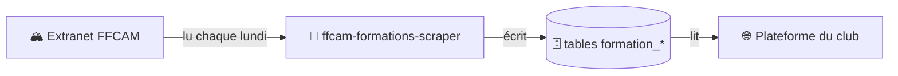
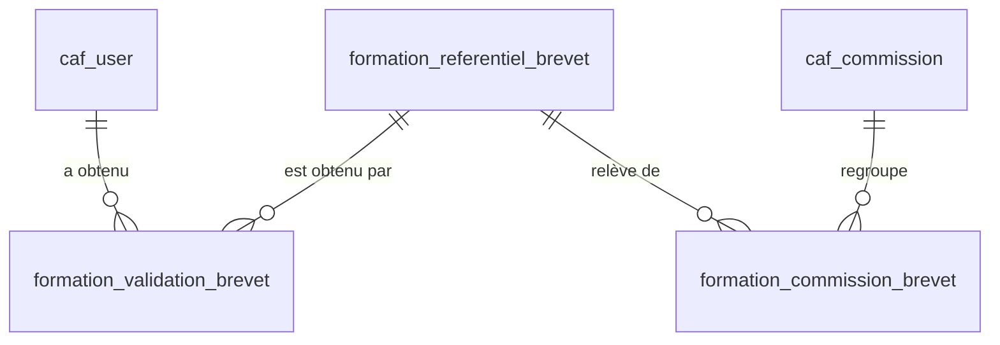

# Formations, brevets et compétences FFCAM

Le site affiche les **formations**, **brevets**, **niveaux de pratique** et **groupes de compétences** des adhérents : sur leur profil, sur la fiche d'une sortie et sur la page « Brevets & co » de chaque commission.

Ces données viennent de l'extranet FFCAM. La plateforme crée les tables et les lit, mais ne les remplit pas : c'est le rôle d'un programme à part, [ffcam-formations-scraper](https://github.com/Club-Alpin-Lyon-Villeurbanne/ffcam-formations-scraper), qui tourne chaque lundi matin sur GitHub Actions pour Lyon, Chambéry et Clermont-Ferrand.



Pour comprendre l'import lui-même (ce qu'il lit, comment il range, que faire d'une alerte), voir sa documentation : [Comment ça marche](https://github.com/Club-Alpin-Lyon-Villeurbanne/ffcam-formations-scraper/blob/main/docs/comment-ca-marche.md).

## Les tables

Chaque type de donnée a trois tables :

- **le référentiel** : le catalogue, une ligne par code FFCAM. `BF1-ES-SAE` n'y figure qu'une fois, même si 40 adhérents l'ont ;
- **les validations** : qui a quoi, avec les dates. Une ligne par adhérent et par élément, reliée à `caf_user` ;
- **les rattachements** : à quelle(s) commission(s) appartient chaque élément du catalogue, relié à `caf_commission`.

| Donnée | Référentiel | Validations | Rattachements aux commissions |
|---|---|---|---|
| Formations | `formation_referentiel_formation` | `formation_validation_formation` | `formation_commission_formation` |
| Brevets | `formation_referentiel_brevet` | `formation_validation_brevet` | `formation_commission_brevet` |
| Niveaux de pratique | `formation_referentiel_niveau_pratique` | `formation_validation_niveau_pratique` | `formation_commission_niveau_pratique` |
| Groupes de compétences | `formation_referentiel_groupe_competence` | `formation_validation_groupe_competence` | `formation_commission_groupe_competence` |

Exemple avec les brevets ; les trois autres types suivent le même modèle :



La table `formation_last_sync` garde, pour chaque type, la date du dernier import complet et le nombre de lignes importées.

### Les colonnes utiles

| Table | Colonnes |
|---|---|
| Référentiel des formations et des brevets | `code_formation` ou `code_brevet` (unique), `intitule` |
| Référentiel des niveaux | `cursus_niveau_id` (identifiant FFCAM, unique), `code_activite`, `activite`, `niveau`, `libelle` |
| Référentiel des groupes de compétences | `intitule`, `code_activite`, `activite` |
| Validations des formations | `user_id`, `formation_id`, `date_validation`, `numero_formation`, `validateur` |
| Validations des brevets | `user_id`, `brevet_id`, `date_obtention`, `date_recyclage`, `date_formation_continue` |
| Validations des niveaux | `user_id`, `cursus_niveau_id`, `date_validation` |
| Validations des groupes de compétences | `user_id`, `competence_id`, `date_validation`, `est_valide`, `valide_par` |
| Rattachements | `commission_id` et l'identifiant de l'élément : `formation_id`, `brevet_id`, `niveau_id` ou `groupe_competence_id` |

### Les règles de la base

- Un adhérent n'a qu'une validation par élément : `(user_id, élément)` est unique.
- Supprimer un adhérent supprime ses validations.
- Un élément du catalogue encore validé par quelqu'un ne peut pas être supprimé.
- Supprimer une commission, ou un élément du catalogue, supprime ses rattachements.
- L'anonymisation d'un compte supprime ses brevets.

Les tables sont créées et modifiées par les migrations Doctrine du dossier `migrations/`. La migration `Version20251128142134` leur a donné leurs noms actuels.

## Qui range quoi dans quelle commission ?

C'est l'import qui décide, en deux étapes : des règles communes à tous les clubs associent chaque code FFCAM à une commission, puis la correspondance propre à chaque club traduit ce code dans celui de ses commissions. Le détail est dans [Le rangement par commission](https://github.com/Club-Alpin-Lyon-Villeurbanne/ffcam-formations-scraper/blob/main/docs/comment-ca-marche.md#le-rangement-par-commission).

La plateforme ne garde aucune liste de codes : elle lit les rattachements. Un brevet affiché dans la mauvaise commission se corrige donc **dans le dépôt de l'import**, pas ici. La marche à suivre est dans [Suivre et dépanner l'import](https://github.com/Club-Alpin-Lyon-Villeurbanne/ffcam-formations-scraper/blob/main/docs/suivre-et-depanner.md).

Seule exception : les deux formations générales, UFCA (`STG-UFFG10`) et PSC1 (`STG-PSC1`), affichées par leur code quelle que soit la commission.

## Ce que la plateforme affiche

Tout cet affichage dépend de la variable d'environnement `AFFICHER_COMPETENCES`.

| Page | Ce qu'elle montre |
|---|---|
| **« Brevets & co » d'une commission** (`/commissions/{id}/brevets`) | Pour chaque membre du staff (responsables, bénévoles, encadrants, co-encadrants, stagiaires) : les brevets et les formations rattachés à la commission qu'au moins un membre du staff détient, les niveaux de pratique rattachés, l'UFCA et le PSC1 |
| **Liste des commissions** (`/commissions`) | Le lien « 🎓 Brevets & co », pour chaque commission qui a au moins un brevet, une formation ou un niveau rattaché |
| **Profil complet d'un adhérent** | Ses niveaux de pratique et ses groupes de compétences, commission par commission, l'UFCA et le PSC1 |
| **Fiche d'une sortie** | Les niveaux de pratique et les groupes de compétences des participants, pour la commission de la sortie, et le PSC1 |

Pour un brevet, la date affichée est celle de la dernière formation continue, sinon du dernier recyclage, sinon de l'obtention.

## Requêtes utiles

```sql
-- Les brevets d'un adhérent, avec leurs commissions
SELECT r.code_brevet, r.intitule, v.date_obtention, v.date_recyclage, v.date_formation_continue,
       GROUP_CONCAT(c.code_commission) AS commissions
FROM formation_validation_brevet v
JOIN caf_user u ON u.id_user = v.user_id
JOIN formation_referentiel_brevet r ON r.id = v.brevet_id
LEFT JOIN formation_commission_brevet fc ON fc.brevet_id = r.id
LEFT JOIN caf_commission c ON c.id_commission = fc.commission_id
WHERE u.cafnum_user = '690012345678'
GROUP BY r.id, v.id;

-- Les formations rattachées à une commission
SELECT r.code_formation, r.intitule
FROM formation_commission_formation fc
JOIN caf_commission c ON c.id_commission = fc.commission_id
JOIN formation_referentiel_formation r ON r.id = fc.formation_id
WHERE c.code_commission = 'escalade'
ORDER BY r.code_formation;

-- La date du dernier import de chaque type
SELECT * FROM formation_last_sync;
```
